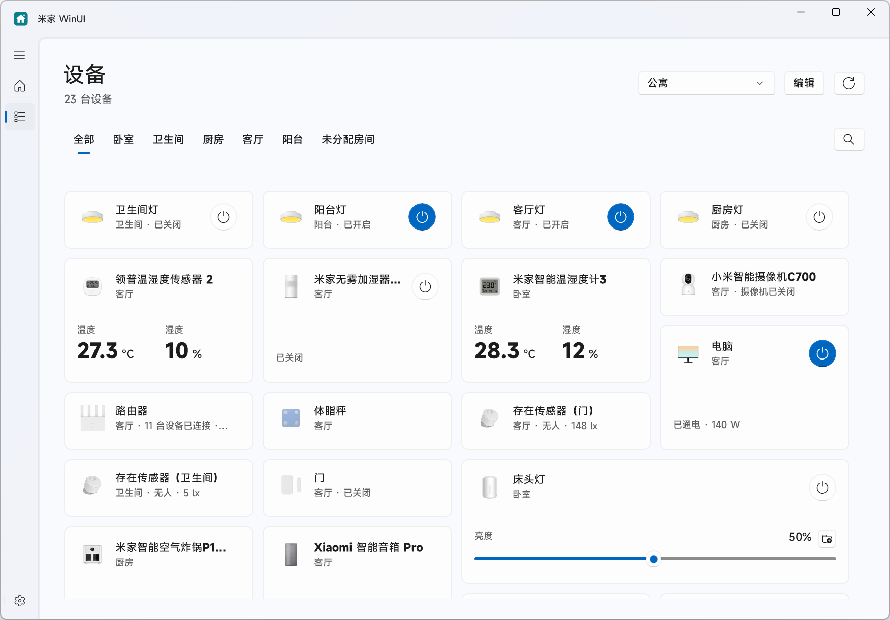

# 米家 WinUI

使用 WinUI 3 构建的米家设备 Windows 桌面客户端，基于 [mijia-api](https://github.com/Do1e/mijia-api) 连接米家服务。

## 功能

- 查看家庭环境、照明、门窗感应和网络状态。
- 按房间浏览设备，将常用设备固定到首页。
- 调整设备卡片的顺序和尺寸，在卡片或详情抽屉中控制设备。
- 导入设备适配包，扩展卡片、控制面板和设备动作。
- 切换浅色、深色主题，使用简体中文或英文界面。
- 检查并下载新版本。

## 安装

支持 Windows 11 x64 和中国大陆账号。

1. 从 [Releases](https://github.com/hugsyf/mijia-winui/releases/latest) 下载并运行安装包。
2. 打开“米家 WinUI”，选择“扫码登录”。
3. 使用手机米家 App 扫码并确认登录。

安装包包含运行环境，无需单独安装 .NET 或 Python。后续更新可在“设置 → 关于软件”中检查。

## 设备适配

内置适配覆盖照明、开关、插座、温湿度传感器等设备，具体功能取决于设备规格。参见[设备适配范围](docs/device-card-adaptation.md)。

对于使用默认面板的设备，可以导出适配资料，将资料和 SDK 交给自己的 Agent 生成适配包，再在“设置 → 设备适配”中导入。支持批量导出和导入。

- [适配包 SDK](sdk/README.md)
- [开发指南](backend/adapter-agent-guide.md)
- [适配示例](examples/adapters)

目前尚不支持配网、场景与自动化、摄像机视频、历史曲线和 MIOT Events 订阅。

## 参与项目

请通过 [Issues](https://github.com/hugsyf/mijia-winui/issues) 反馈问题或提出建议。反馈设备问题时，请提供设备型号和复现步骤。

构建与贡献说明见 [CONTRIBUTING](CONTRIBUTING.md)，更多开发资料见[文档目录](docs/README.md)。

## 致谢

- [Do1e/mijia-api](https://github.com/Do1e/mijia-api)：米家服务接口。
- [WinUI](https://github.com/microsoft/microsoft-ui-xaml)：Windows 原生界面框架。
- [MIOT-Spec](https://miot-spec.org)：设备规格与多语言资料。

## 开源许可

项目代码采用 [GPL-3.0-or-later](LICENSE)。第三方组件许可见[第三方声明](THIRD-PARTY-NOTICES.md)，也可在应用的“开源许可”中阅读。

修改或再分发时，请遵守 GPL 的源码提供、许可和版权声明要求。

## 免责声明

- 米家相关名称及标识的权利归小米所有；WinUI 相关名称及标识的权利归 Microsoft 所有。
- 本项目与小米或 Microsoft 无隶属关系。
- 本项目仅供学习交流使用，不得用于商业用途，如有侵权请联系删除。
- 使用时请遵守相关法律和米家服务条款，用户使用本项目所产生的任何后果，需自行承担风险，开发者不对使用本项目产生的任何直接或间接损失负责。
